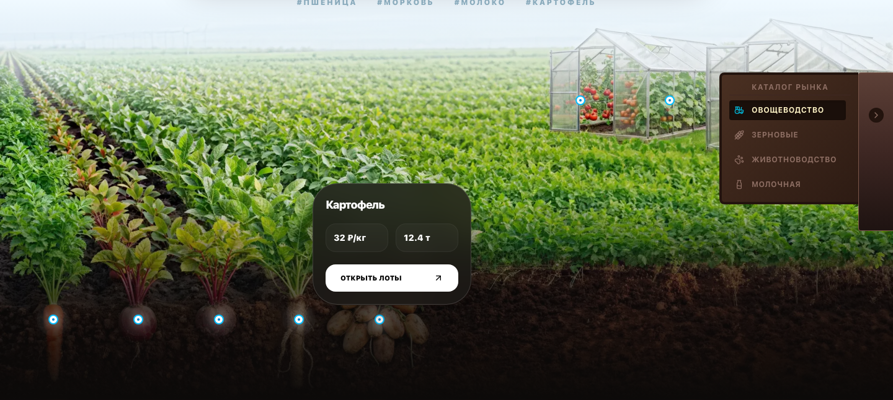
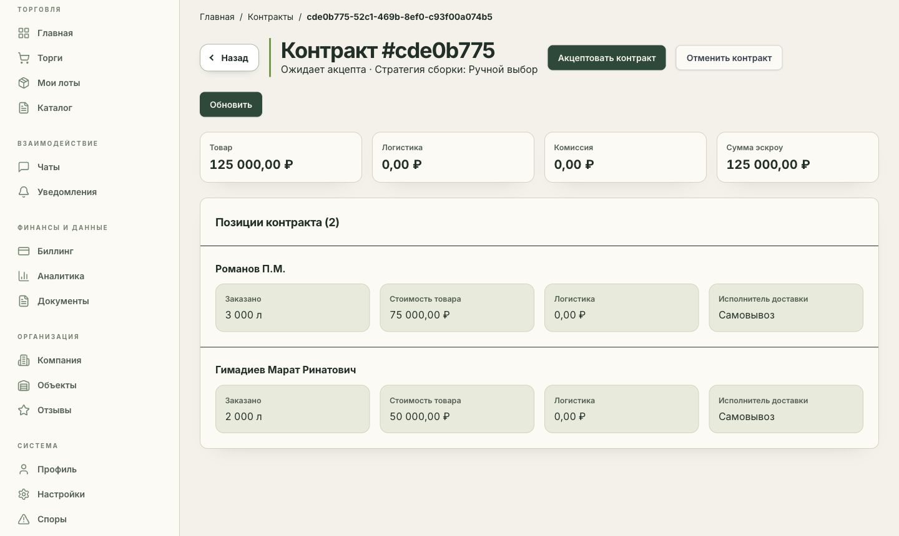

# AgroConnect

### B2B-платформа для фермеров и закупщиков

Я — **Закирзянов Самат Расихович**, автор и разработчик AgroConnect. Я спроектировал и разработал платформу, которая связывает предложения производителей с потребностями закупщиков: каталог, производственные мощности, заявки, формирование сделок, документы и коммуникацию компаний.

В этом репозитории я показываю интерфейс и разбираю инженерные решения. Основной исходный код храню в закрытом репозитории.

[Интерфейс](docs/gallery.md) · [Видео](https://minemaps251-ship-it.github.io/agroconnect-showcase/) · [Сценарий закупки](docs/product.md) · [Архитектура](docs/architecture.md) · [Инженерные кейсы](docs/engineering-cases.md) · [Проверки](docs/verification.md)

## Зачем я создал AgroConnect

В оптовой закупке недостаточно найти товар. Нужно сопоставить объём и период поставки, собрать предложения, согласовать условия и сохранить связь между договорённостями, документами и исполнением.

Я объединил эти задачи в одном приложении. Закупщик работает с потребностью и откликами, поставщик — с продукцией и доступными мощностями. Сотрудники компании получают свои полномочия, а доступ к объектам учитывает принадлежность компании.

## Пример работы

Закупщику нужно 5 000 л молока в заданный период. Один поставщик предлагает 3 000 л, другой — 2 000 л. В целевом сценарии закупщик собирает предложения в сделку, а приложение связывает выбранные позиции с резервами, документами и дальнейшими действиями сторон.

Это вымышленный пример для объяснения предметной модели. [По шагам: кто что делает и какие сущности участвуют →](docs/product.md)

## Что я реализовал

| Область | Мой результат |
| --- | --- |
| Каталог | Товары, категории, характеристики и карточки продукции |
| Мощности | Складской остаток, периодическое производство, будущий урожай и резервирование |
| Закупки | Лоты, заявки, приглашения и формирование сделок из предложений |
| Компании | Участники, сотрудники, приглашения, роли и объектные проверки доступа |
| Сопровождение сделки | Документы и PDF, чаты, уведомления, споры и отзывы |
| Финансовый учёт | Удержания, проводки, идемпотентность и сохранённые финансовые события |
| Кабинеты | Интерфейсы участников и администратора, русская и английская локализация |

Я отвечаю за весь цикл: предметную модель, архитектуру, frontend, backend, схему базы, инфраструктуру и автоматизированные проверки. Ниже — три задачи, на которых можно подробнее оценить мой подход.

## Ключевые инженерные решения

- **Изоляция компаний:** проверяю не только роль, но и контекст компании, действие и принадлежность конкретного объекта.
- **Резервирование:** связываю расчёт доступности с транзакцией и блокировкой, чтобы ошибка не оставляла частичный резерв.
- **Финансовый outbox:** сохраняю событие вместе с проводкой, а повторную обработку делаю безопасной для потребителя.

[Разбор задач, альтернатив, отказов и проверок →](docs/engineering-cases.md)

## Стек и архитектура

| Слой | Технологии |
| --- | --- |
| Frontend | TypeScript, Next.js 16, React 19, RTK Query, Tailwind CSS, next-intl |
| Backend | NestJS 11, TypeORM, REST, Socket.IO |
| Данные | PostgreSQL, PostGIS, Redis |
| Идентификация и файлы | Keycloak / OpenID Connect, BFF-сессия, MinIO / S3 API |
| Среда и проверки | Docker Compose, Jest, PostgreSQL integration tests, Playwright |

Я выбрал модульный монолит: домены разделены внутри приложения, а связанные изменения данных можно выполнять в общей транзакции. Между frontend и backend переиспользую TypeScript-контракты.

[Схема, границы компонентов и причины выбора →](docs/architecture.md)

## Посмотреть приложение

[Галерея интерфейса](docs/gallery.md) · [Видео в браузере](https://minemaps251-ship-it.github.io/agroconnect-showcase/)

Кадры закупщика я снял в авторизованном приложении на разрешённых демонстрационных данных. Видео — обзор по этим кадрам с русскими подписями. Акцепт, платежи и поставку в ходе съёмки я не выполнял. [Подробнее о демонстрации →](docs/demo-script.md)

## Текущий статус

**Проект не завершён.** До production я планирую завершить системную приёмку, необходимые доработки, проверки безопасности и интеграций, длительные нагрузочные испытания и подготовку эксплуатации.

**Последние изменения проекта: середина июня 2026 года.**

[Что реализовано и что ещё требует допуска →](docs/quality.md) · [Сохранённый пример проверок →](docs/verification.md) · [Следующие этапы →](docs/roadmap.md)

## Связаться со мной

**Закирзянов Самат Расихович** · [GitHub](https://github.com/minemaps251-ship-it)

Готов обсудить архитектуру, предметную модель и принятые решения на техническом собеседовании. Вопрос о проекте также можно оставить в [Issues](https://github.com/minemaps251-ship-it/agroconnect-showcase/issues).

Это демонстрационный репозиторий: приложения и инструкции запуска закрытого проекта в него не входят. [Использование материалов](RIGHTS.md).
