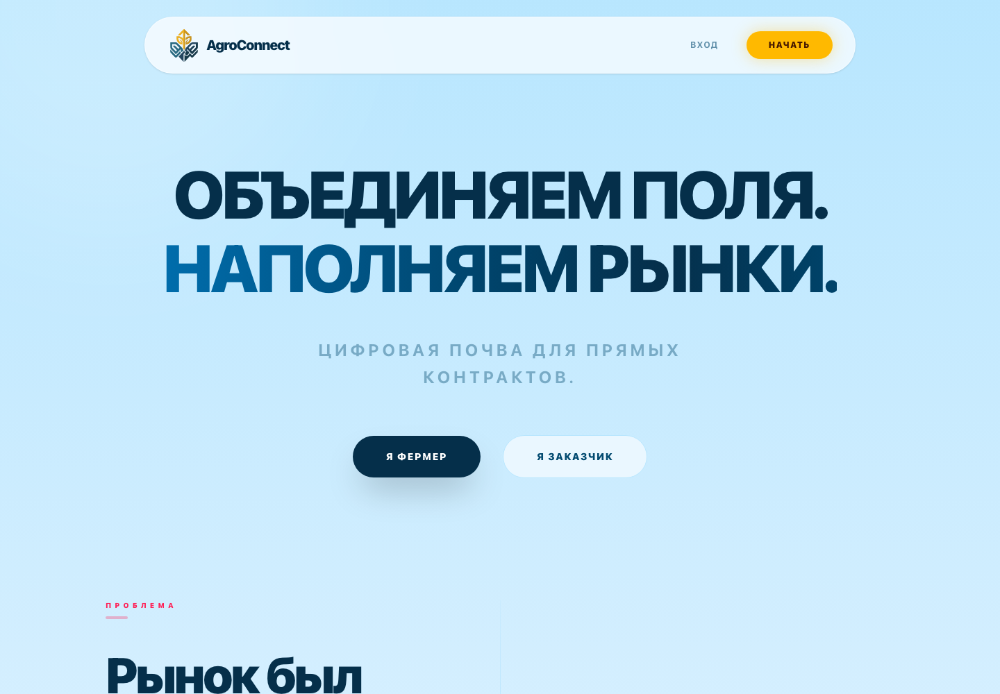
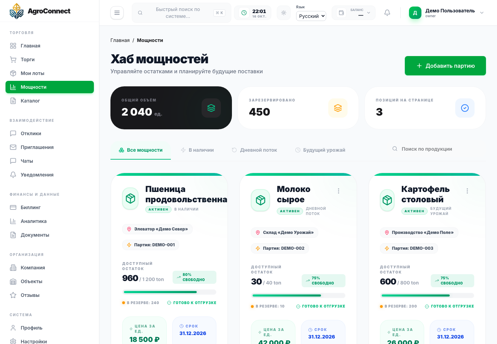

# AgroConnect

### B2B-платформа для фермеров и закупщиков

AgroConnect объединяет каталог продукции, производственные мощности, заявки, сделки, документы и коммуникацию компаний в одном приложении.

**Статус: незавершённый проект, подготовка к production.**

Основные функциональные области реализованы. До промышленного запуска предстоит завершить доработки и комплексную приёмку: проверить систему целиком, устойчивость под нагрузкой и при отказах, безопасность, внешние интеграции и процедуры эксплуатации.

**Последние изменения проекта: середина июня 2026 года** — дата указана владельцем. Даты подготовки этой витрины и демонстрационных материалов приводятся отдельно.

Этот репозиторий — публичная витрина проекта для работодателей и технических специалистов. Основная реализация хранится отдельно и не входит в эту публикацию.

[Скриншоты](docs/gallery.md) · [Видеообзор](assets/video/interface-tour.webm) · [Обзор продукта](docs/product.md) · [Архитектура](docs/architecture.md) · [Инженерные кейсы](docs/engineering-cases.md) · [Качество и ограничения](docs/quality.md)

## Какую задачу решает проект

Закупщику нужно найти подходящую продукцию, согласовать объём и условия поставки. Фермеру — представить предложение и управлять доступными мощностями. При этом сотрудники одной компании должны работать совместно, а данные разных компаний — оставаться изолированными.

AgroConnect создаёт общее рабочее пространство для этого процесса: от предложения и заявки до сопровождения сделки.

## Возможности

| Область | Возможности приложения |
| --- | --- |
| Каталог | Продукция, категории и характеристики |
| Предложения и мощности | Производственные мощности, объекты, доступность и резервирование |
| Закупки | Торги, заявки, приглашения и согласование условий |
| Сделки | Объединение позиций в бандлы и работа с контрактами |
| Командная работа | Компании, сотрудники, приглашения и роли |
| Коммуникация | Чаты, уведомления и споры |
| Документы | Формирование документов, файловое хранение и экспорт |
| Финансовый контур | Учёт средств, резервирование и обработка финансовых событий |
| Интерфейс | Русская и английская локализация, кабинеты участников |

Наличие модуля не означает завершённую приёмку всей цепочки. Подключение реальных расчётов, юридически значимой подписи и допуск к production требуют отдельных проверок — подробнее в [статусе качества](docs/quality.md).

## Мой вклад

Я — автор и разработчик AgroConnect. Разработка всего проекта и всех его частей была на мне: от продуктовой идеи и архитектуры до frontend, backend, базы данных, инфраструктуры и проверок.

В рамках проекта я работаю над:

- предметной моделью и бизнес-процессами B2B-платформы;
- интерфейсами закупщика, поставщика и административной части;
- серверными API, авторизацией и изоляцией данных компаний;
- схемой базы данных, транзакциями и фоновыми обработчиками;
- интеграциями, контейнерной средой и автоматизированными проверками.

Примеры технических задач разобраны в [инженерных кейсах](docs/engineering-cases.md).

## Техническая основа

| Слой | Технологии |
| --- | --- |
| Frontend | TypeScript, Next.js 16, React 19, Redux Toolkit / RTK Query, next-intl |
| Backend | TypeScript, NestJS 11, TypeORM, REST, Socket.IO |
| Данные | PostgreSQL, PostGIS |
| Идентификация | Keycloak, OpenID Connect, серверная BFF-сессия |
| Инфраструктура | Redis, MinIO, Docker Compose |
| Проверки | Jest, интеграционные тесты с PostgreSQL, Playwright |

Backend организован как **модульный монолит**: доменные модули разделяют ответственность, а общие TypeScript-контракты используются frontend и backend. [Подробнее об архитектуре →](docs/architecture.md)

## Три инженерных задачи

1. **Изоляция компаний.** Проверка принадлежности объектов, полномочий сотрудников и запросов с чужими идентификаторами.
2. **Резервирование мощностей.** Согласование доступности, ограничений периода и транзакционного отката.
3. **Надёжная доставка финансовых событий.** Сохранение события вместе с финансовой операцией, повторная обработка и защита от дублирования уведомлений.

[Разбор проблем, решений и способов проверки →](docs/engineering-cases.md)

## Демонстрационные материалы

**[Посмотреть 8 экранов →](docs/gallery.md)** · **[Открыть видеообзор интерфейса →](assets/video/interface-tour.webm)**

Кабинет снят на вымышленных данных с отдельным API только для чтения. Видео показывает навигацию по интерфейсу; отправка форм, сделки и платежи в нём не выполняются. [Как подготовлена демонстрация →](docs/demo-script.md)

## Развитие проекта

До production остаются сквозная приёмка бизнес-сценариев, финальная проверка интерфейса, безопасности и интеграций, нагрузочные и аварийные испытания, подготовка развёртывания, восстановления и ограниченного пилота. [Направления развития →](docs/roadmap.md)

## Связь

[Профиль GitHub](https://github.com/minemaps251-ship-it)

Для обсуждения проекта можно создать [обращение в этом репозитории](https://github.com/minemaps251-ship-it/agroconnect-showcase/issues).

Основной код остаётся закрытым. Опубликованные материалы позволяют познакомиться с продуктом и обсудить технические решения. [Условия использования материалов](RIGHTS.md).

*Описание подготовлено по состоянию на 16 октября 2026 года. Это обзор проекта, а не дистрибутив приложения: запуск из этого репозитория не предусмотрен.*
