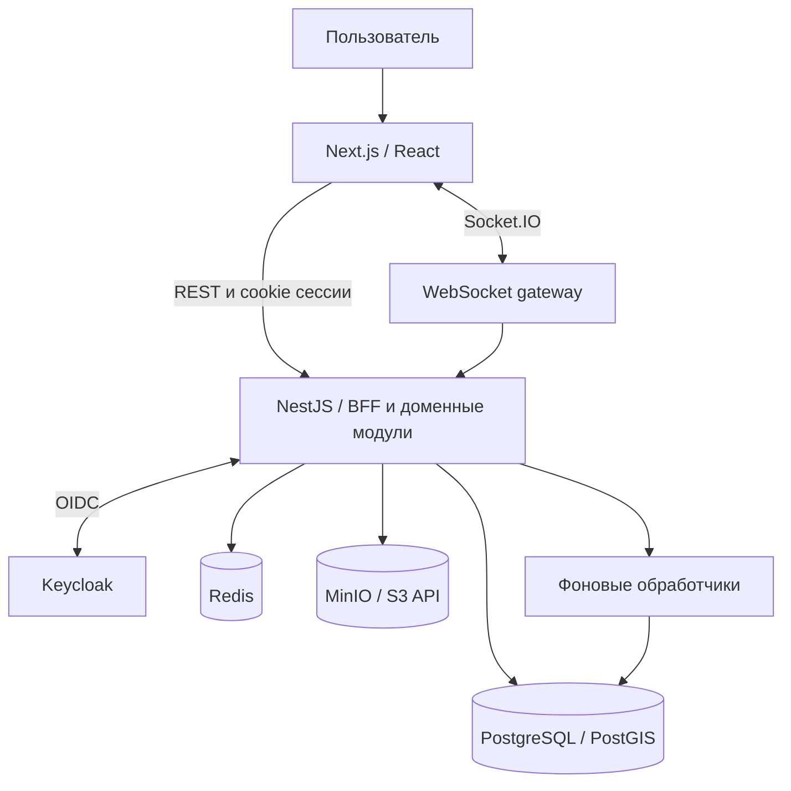

# Архитектура и мой выбор решений

[← На главную](../README.md)

## Общая схема

Я показываю логические связи. Gateway и фоновые обработчики — части приложения; отдельные блоки не означают независимые микросервисы.

## Почему модульный монолит

Я разделил backend на доменные модули: идентификация, компании, каталог, мощности, торги, сделки, биллинг, документы и коммуникация. Контроллер принимает запрос, сервис отвечает за бизнес-операцию, слой данных — за хранение и транзакционные ограничения.

Для связанного процесса закупки общая PostgreSQL-транзакция позволяет согласовать несколько изменений. Это проще для проверки целостности и эксплуатации, чем распределённая транзакция между сервисами.

Компромисс — домены развёртываются вместе, а независимое масштабирование ограничено границами процесса. Выделение сервисов я рассматриваю как следующий шаг при измеренной необходимости, а не как обязательное свойство большого проекта.

## Интерфейс и контракты

В Next.js я группирую интерфейс по функциональным областям. RTK Query использую для клиентских REST-запросов и кеша, next-intl — для локализации. Общие компоненты образуют единый каркас кабинета.

В пакете `@agroconnect/shared` переиспользую типы и контракты между приложениями. TypeScript помогает при разработке, но не проверяет входящий JSON: на сервере остаются DTO и runtime-валидация.

## Идентификация и доступ

Я использую Keycloak как OpenID Connect-провайдера и серверную BFF-сессию приложения. REST-запросы клиента отправляют cookies и CSRF-заголовок. Идентификация пользователя отделена от решения о доступе к бизнес-объекту.

Для корпоративного действия я учитываю контекст компании, полномочия и принадлежность объекта. WebSocket-подключение и доступ к комнатам требуют собственных проверок; успешный HTTP-вход не заменяет их.

## Роль хранилищ

| Компонент | Как я его использую |
| --- | --- |
| PostgreSQL | Доменные данные, транзакции, ограничения, резервы и сохранённые события |
| PostGIS | Географические данные и запросы |
| Redis | Ограничение частоты запросов и вспомогательные механизмы, включая опциональный кеш каталога |
| MinIO | Хранение файлов через S3-совместимый API |

Redis не является источником финансовой истины. Файл в хранилище и запись о нём в базе требуют согласованной обработки ошибок: наличие одного не доказывает успешное завершение всей операции.

## Как проходит резервирование

1. HTTP-уровень устанавливает пользователя, проверяет полномочия и входные данные.
2. Сервис выполняет доменные проверки для выбранного предложения и периода.
3. При резервировании `AvailabilityService` использует активную транзакцию и блокирует строку мощности на запись.
4. Стратегия соответствующего типа рассчитывает и изменяет доступность в той же транзакционной области.
5. Если операция завершается ошибкой, изменения транзакции откатываются.

Это граница резервирования. Финансовые проводки и формирование документов имеют свои правила и не считаются автоматически завершёнными только из-за появления резерва.

## Как доставляется финансовое событие

Я сохраняю событие outbox вместе с финансовой проводкой. Обработчик забирает доступную запись с `SKIP LOCKED`, назначает ограниченную по времени аренду и вызывает потребителя. Подтверждение привязано к токену аренды, чтобы старый обработчик не подтвердил новую выдачу.

При сбое событие остаётся для повтора. Потребитель распознаёт повтор по идентификатору источника; запись уведомления не должна дублироваться. Здесь я опираюсь на повторяемую доставку и идемпотентную обработку, а не на общую гарантию exactly-once для внешних систем.

[Подробности трёх кейсов →](engineering-cases.md) · [Проверки и границы результата →](verification.md)
