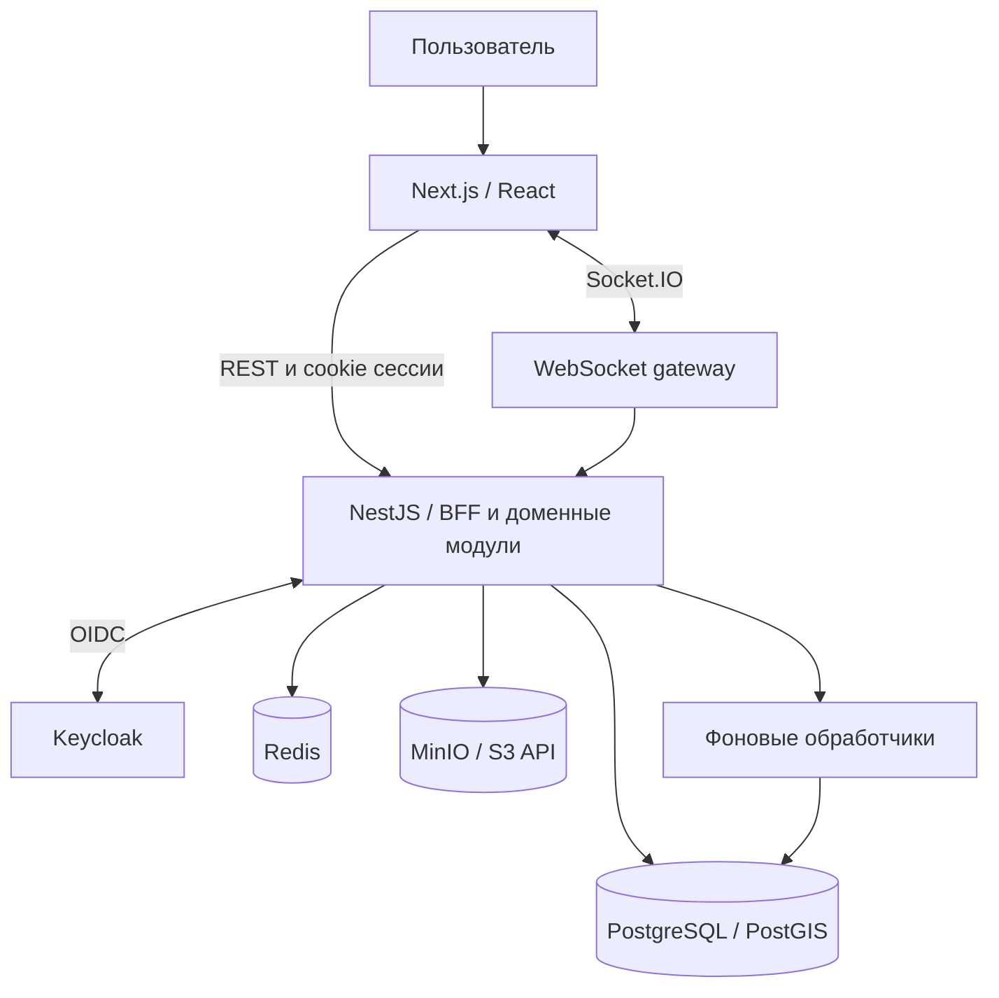

# Архитектура AgroConnect

[← На главную](../README.md)

## Общая схема

Схема показывает логические связи. Она не является схемой production-сетей или перечнем открытых портов.

## Модульный монолит

Backend представляет собой NestJS-приложение с доменными модулями: идентификация, компании, каталог, мощности, торги, бандлы, биллинг, документы и коммуникация.

Этот выбор позволяет использовать транзакции общей базы данных для связанных операций и сохранять единую модель развёртывания. Разделение ответственности поддерживается сервисами, DTO и границами модулей. Выделение микросервисов потребовало бы отдельных оснований по нагрузке и эксплуатации.

## Интерфейс и контракты

Next.js отвечает за страницы и маршруты. Доменные компоненты и API сгруппированы по функциональным областям. RTK Query используется для клиентских REST-запросов и управления кешем; next-intl — для русской и английской локализации.

Общий пакет TypeScript-контрактов связывает frontend и backend. Runtime-валидация входных запросов на сервере остаётся отдельной обязанностью DTO и валидаторов.

## Идентификация и доступ

Keycloak используется как OpenID Connect-провайдер. Приложение работает с серверной BFF-сессией; клиентские REST-запросы отправляют cookies и CSRF-заголовок.

Доступ к бизнес-объекту определяется не только фактом входа. Проверяются контекст компании, принадлежность объекта и полномочия действия. WebSocket-взаимодействия требуют собственных проверок доступа.

## Хранение и фоновые операции

| Компонент | Ответственность |
| --- | --- |
| PostgreSQL | Доменные данные, транзакции, ограничения и сохранённые события |
| PostGIS | Географические данные и запросы |
| Redis | Вспомогательные механизмы, включая ограничение частоты запросов и опциональный кеш каталога |
| MinIO | Файлы через S3-совместимый API |
| Фоновые обработчики | Обработка сохранённых событий и документов с учётом повторов |

## Финансовые события

Финансовая операция и запись outbox сохраняются транзакционно. Обработчик забирает событие с ограниченной по времени арендой, вызывает потребителя и фиксирует доставку. При сбое предусмотрена повторная обработка.

Потребитель должен выдерживать повторную доставку. Такой подход сокращает риск потери события между изменением баланса и отправкой уведомления; он не даёт общей гарантии exactly-once для произвольных внешних систем.

## Эксплуатационные границы

В проекте есть контейнеризация, health/readiness-проверки, логирование и телеметрия. Конфигурации и проверки продолжают развиваться. Публичная схема не подтверждает завершённый production rollout, нагрузочную ёмкость или действующее соглашение об уровне сервиса.
