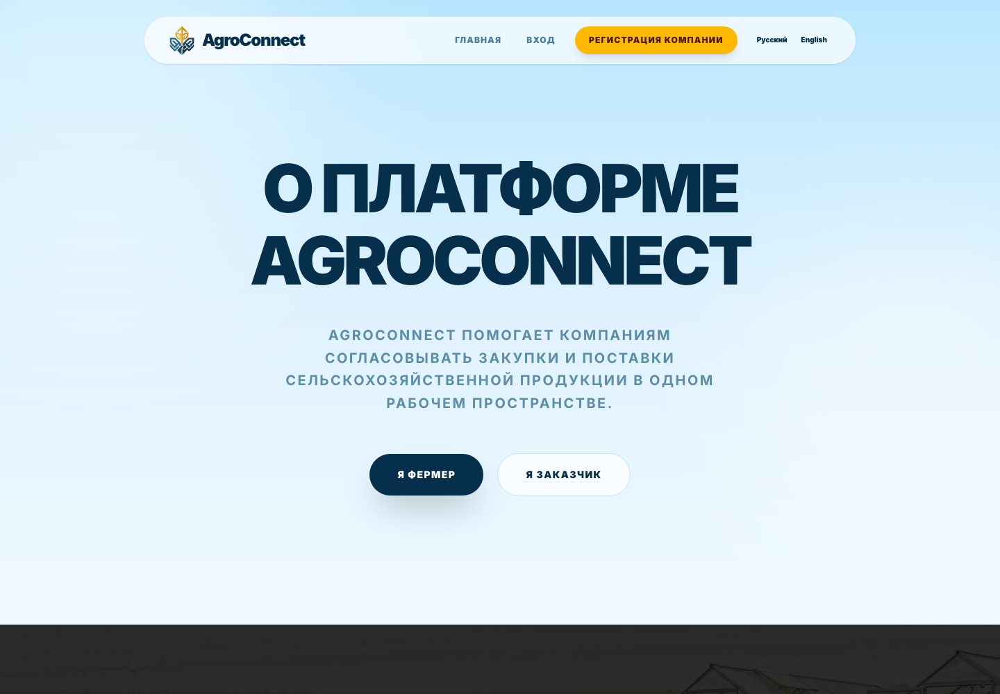
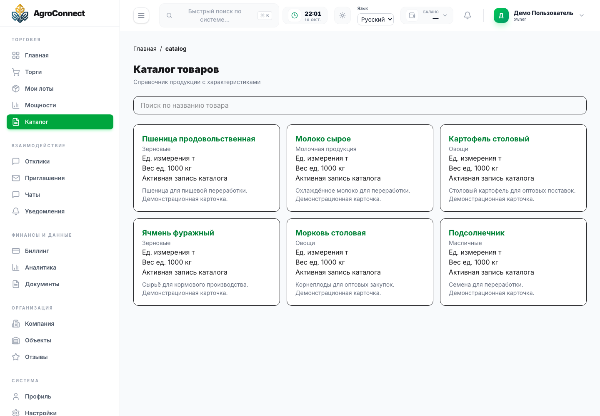
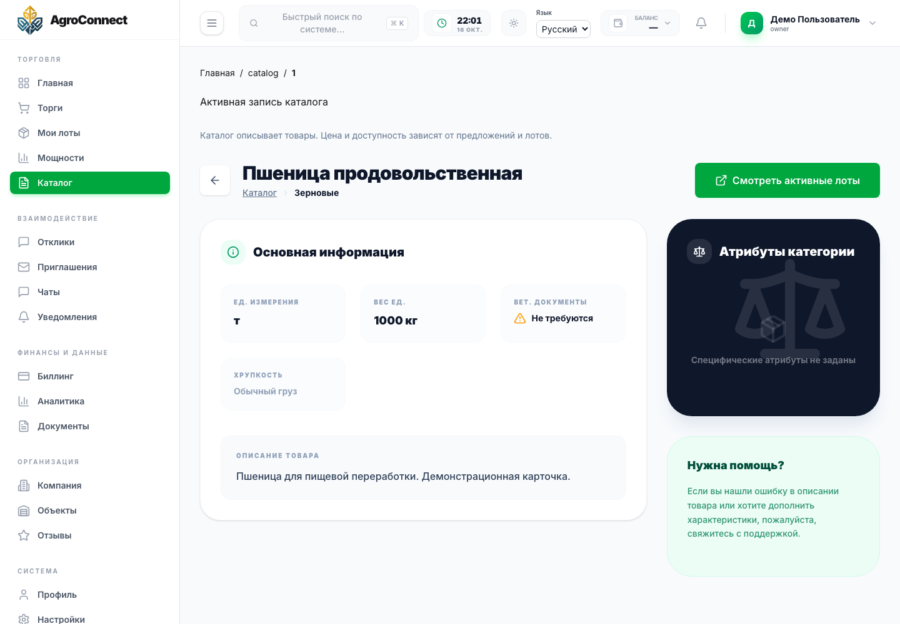
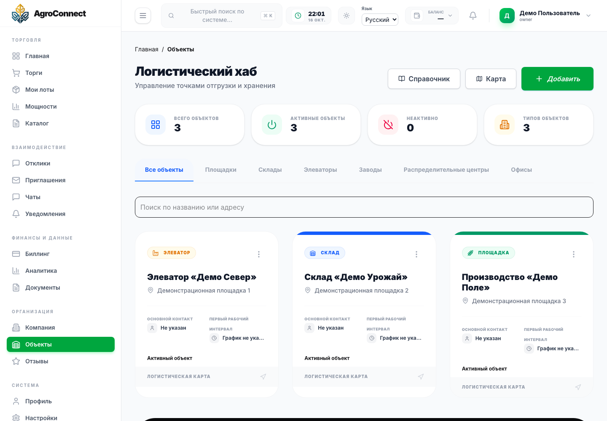
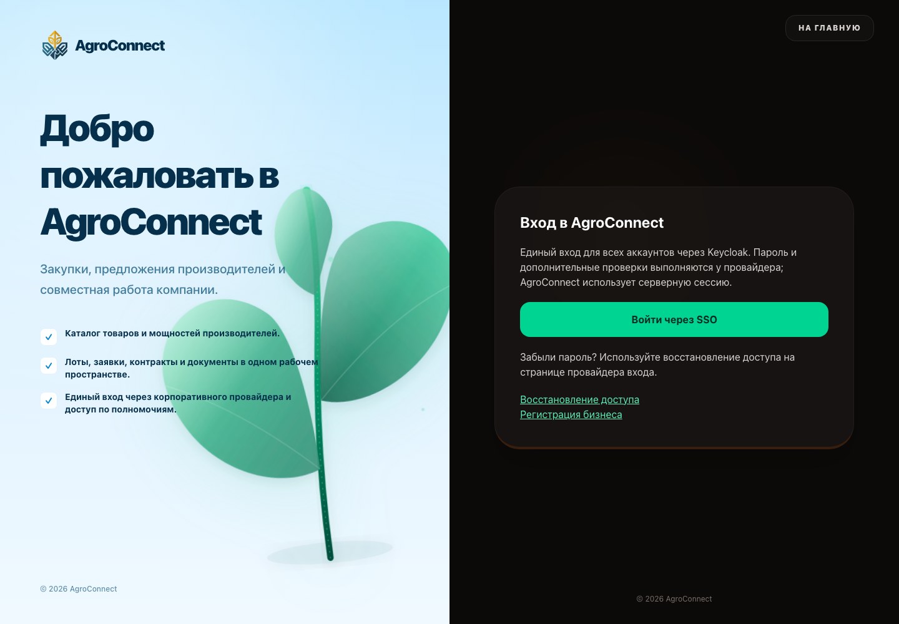
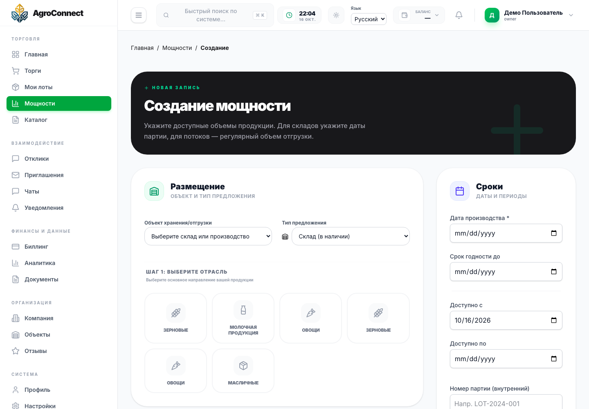

# Интерфейс AgroConnect

[← На главную](../README.md) · [Видеообзор](../assets/video/interface-tour.webm)

Это реальные страницы frontend проекта. Для кабинета использованы синтетические ответы отдельного API только для чтения; рабочая база данных не использовалась. Формы не отправлялись, сделки и платежи в демонстрации не выполнялись.

## Главная: интерактивный выбор продукции

Фотография с точками выбора, раскрытой карточкой продукции и меню категорий. Цены и объёмы этого блока — демонстрационные значения интерфейса.

## Главная страница

Первое знакомство с продуктом и выбор роли участника.

## О платформе

Описание назначения сервиса и возможностей участников.

## Каталог продукции

Закупщик просматривает справочник товаров и их характеристики.

## Карточка товара

Характеристики продукции и переход к связанным предложениям.

## Производственные мощности

Поставщик просматривает доступность, резервы, цены и периоды.

## Логистические объекты

Компания управляет площадками и точками хранения.

## Вход в приложение

Начало пользовательского сценария аутентификации; вход через IdP в этом обзоре не выполняется.

## Создание мощности

Форма предложения: выбор продукции, объекта и параметров. Отправка формы отключена на уровне демонстрационного API.

