# Интерфейс AgroConnect

[← На главную](../README.md) · [Видеообзор](https://minemaps251-ship-it.github.io/agroconnect-showcase/)

Здесь я показываю текущий интерфейс на демонстрационных данных. Кадры закупщика, поставщика и администратора сняты в авторизованном приложении с настоящим backend. Я просматривал существующие записи и использовал поиск и фильтры; акцепт, оплату, загрузку файлов и поставку не выполнял.

Шапка с балансом и личным меню исключена из кадров. Содержимое KYC и реквизиты документов не публикуются.

## Главная: выбор продукции

Я сохранил выбранный кадр главной: фотография, точки выбора, карточка продукции и меню категорий. Цены и объёмы здесь демонстрационные.

## Поиск продукции

Я показываю поиск молочной продукции в каталоге. Каталог описывает товар; цена и доступность относятся к предложениям.

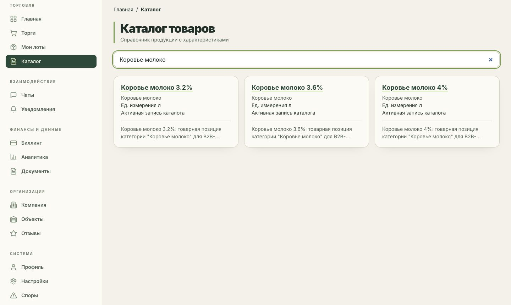

## Карточка товара

Характеристики молока и требования к продукции находятся в отдельной карточке.

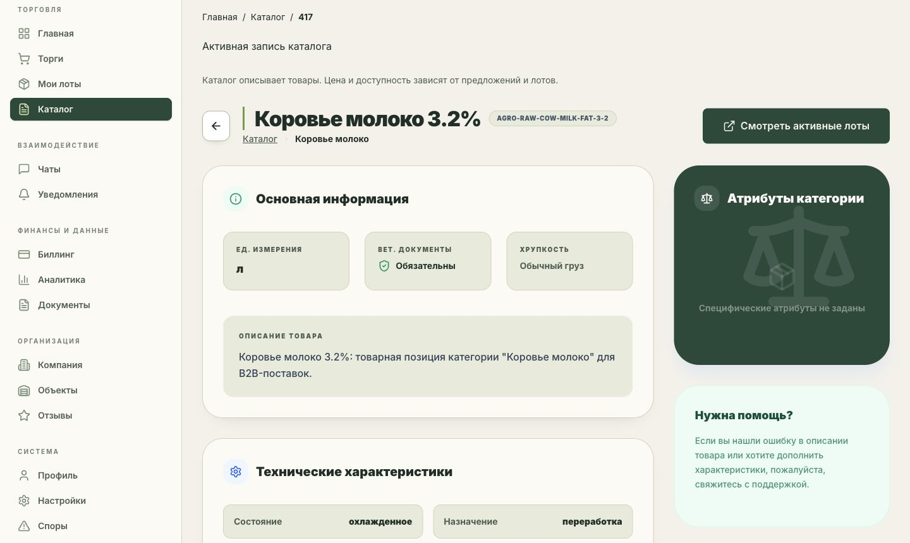

## Закупки компании

В списке видны закупочные кампании, статусы, объёмы и число откликов. В демонстрационном наборе есть закупка 5 000 л молока.

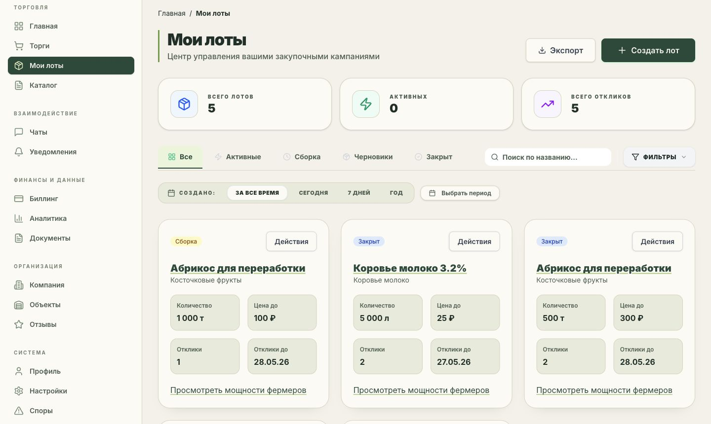

## Состав контракта

Две позиции на 3 000 и 2 000 л образуют 5 000 л. Карточка ожидает акцепта; нажатия подтверждения и отмены в съёмке не выполнялись.

## Документы сделки

Я отфильтровал реестр по договорам. Видны файл, категория и состояние подписи. Содержимое документов не открывалось для публикации.

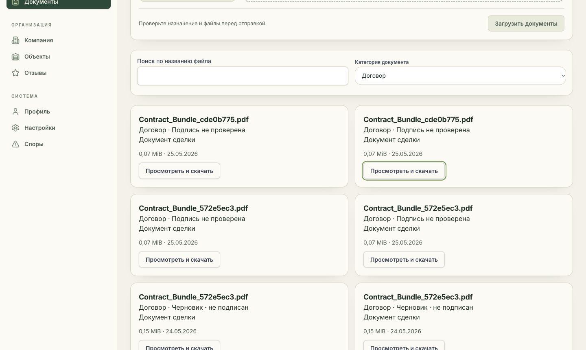

## Участники обсуждения

Панель чата связывает участников с объёмами той же закупки. Сообщения в ходе съёмки я не отправлял.

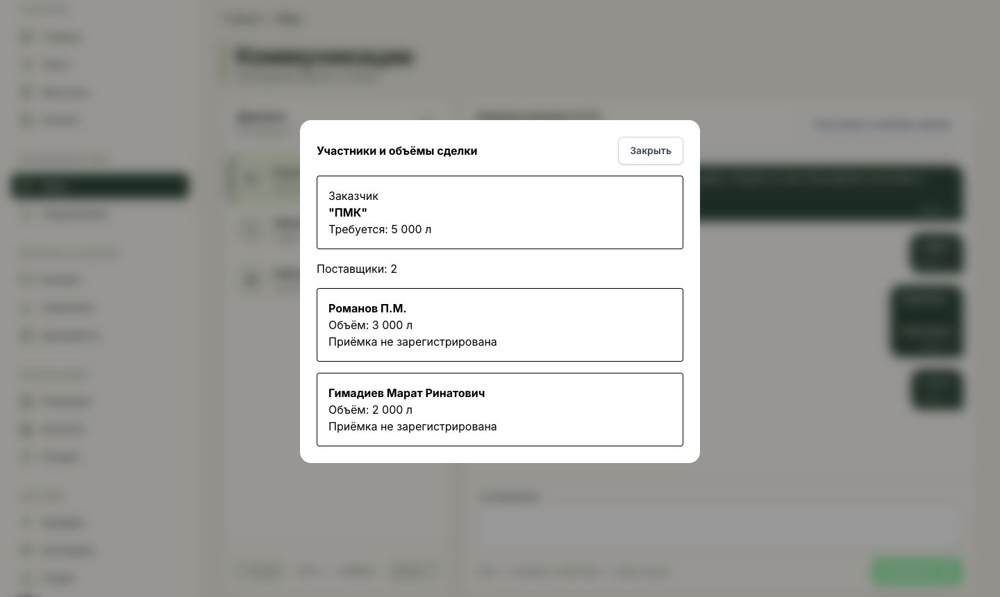

## Мощности поставщика

Я показываю список мощностей: тип предложения, доступность, резерв и цену. В этом демонстрационном наборе есть молочная партия, связанная с показанной закупкой.

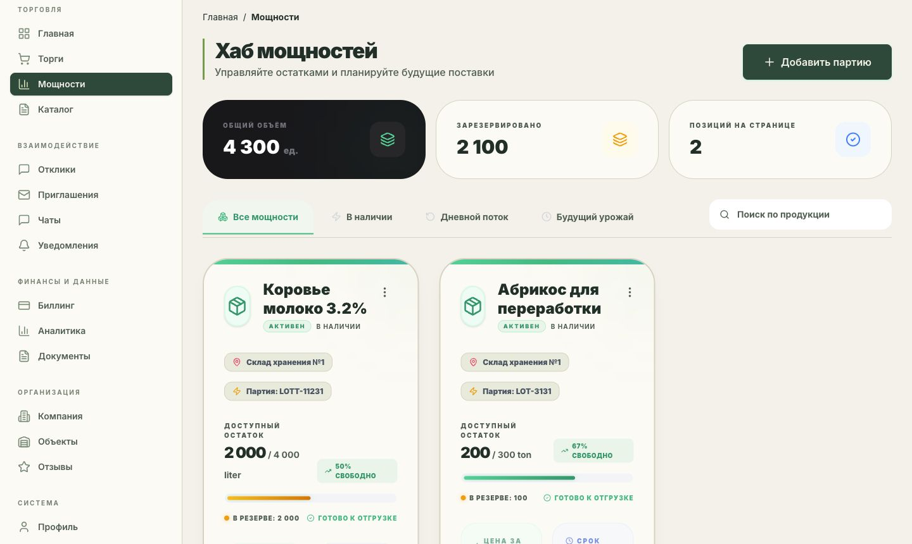

Полная карточка мощности

Здесь видны весь остаток, резерв, цена и срок. Кнопку обновления остатка я не нажимал.

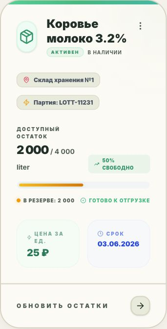

## Отклик поставщика

Поставщик видит предложение на 4 000 л по 25 ₽/л и его состояние. В показанный контракт вошла позиция на 2 000 л; исходный объём отклика и выбранный объём различаются.

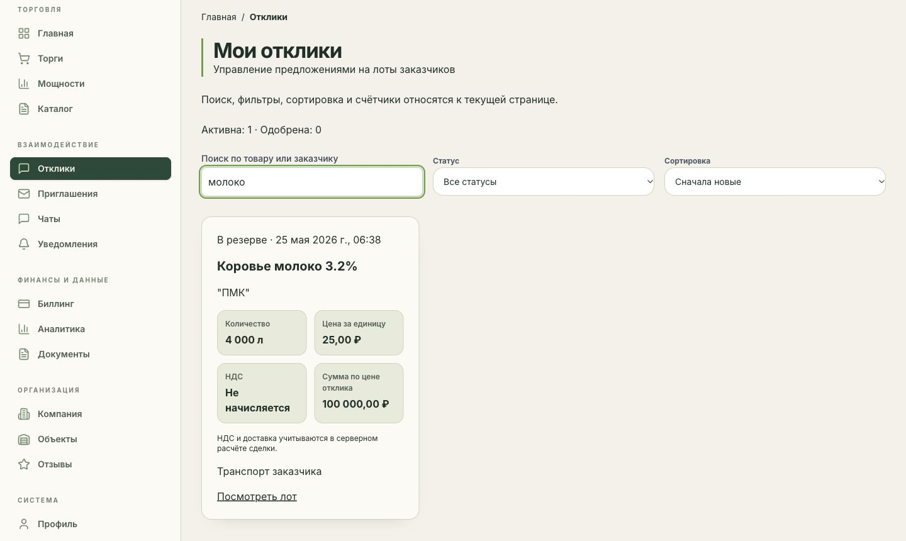

## Мобильный вид

Тот же отклик на узком экране: количество, цена, НДС, сумма по отклику и переход к закупке. Это кадр карточки при ширине окна 390 px, без шапки с балансом.

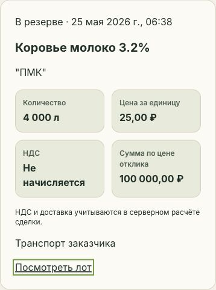

## Кабинет администратора

Я показываю сводные показатели демонстрационного контура. Список пользователей с контактами исключён из кадра.

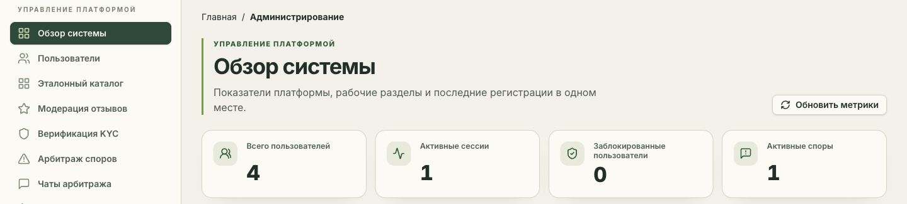

### Эталонный каталог

Товары и единицы измерения доступны в отдельном административном разделе. В ходе съёмки я не создавал товары и не изменял названия.

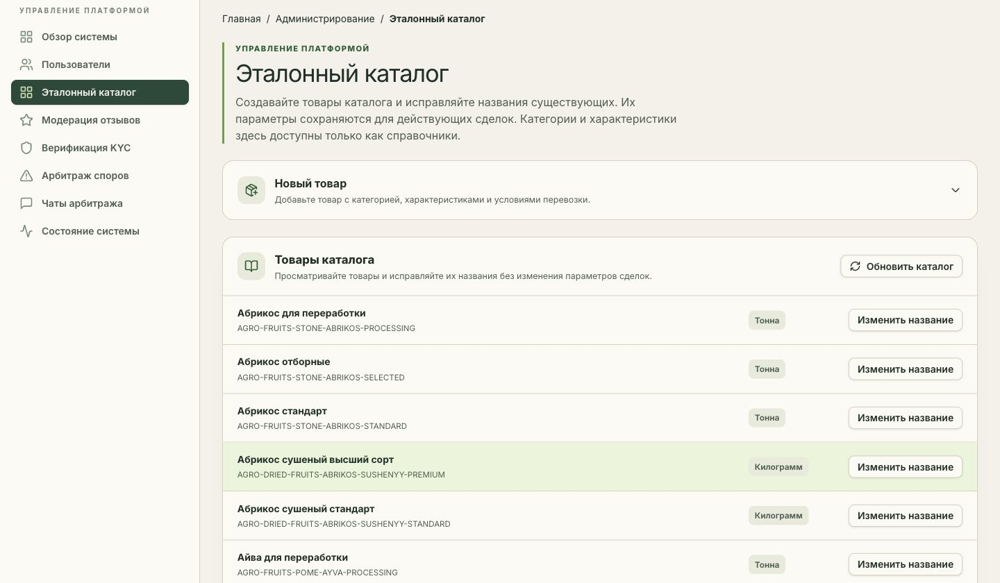

### Диагностика

Панель показывает результаты проверки PostgreSQL/PostGIS, Redis, OIDC и хранилища документов, а также ресурсы процесса backend. Это состояние локального контура в момент съёмки; оно не заменяет эксплуатационную приёмку. Данные сессий и IP в кадр не включены.

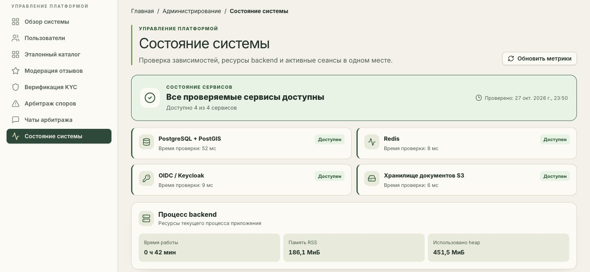
